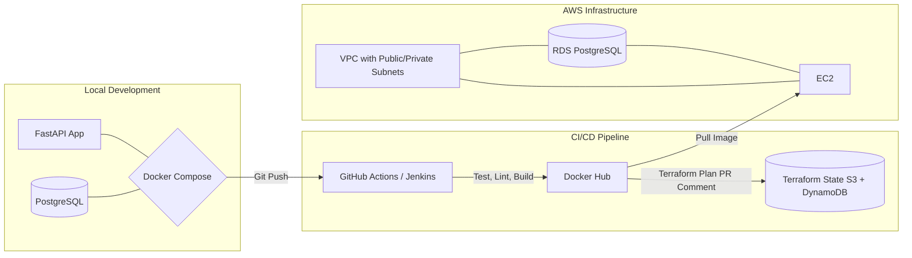

# PulseNotify API

[](https://github.com/koatedevopskpai/pulsenotify-platform/actions/workflows/ci.yml)
[](https://opensource.org/licenses/MIT)

A notification reference microservice built with FastAPI, with Docker, CI/CD and
Terraform configuration for AWS. This claim sweep inspected source wording; it did
not inspect cloud deployment receipts or establish production operation.

## Architecture



## Quick Start

```bash
# Install dependencies
make install

# Run tests
make test

# Start full stack with Docker
make docker-up

# Explore the API
curl http://localhost:8000/health
curl http://localhost:8000/docs
```

## Tech Stack

| Category | Tools |
|---|---|
| **API Framework** | FastAPI, Uvicorn, Pydantic v2 |
| **Database** | PostgreSQL, SQLAlchemy 2.0, Alembic |
| **Containerisation** | Docker, multi-stage builds, Docker Compose |
| **CI/CD** | GitHub Actions, Jenkins, Dependabot |
| **IaC** | Terraform (S3 backend, DynamoDB locking, VPC, RDS, EC2, Secrets Manager) |
| **Testing** | Pytest, pytest-cov, FastAPI TestClient, isolated SQLite fixtures |
| **Observability** | Prometheus metrics, structured logging, DB-aware health checks |
| **Code Quality** | Flake8, pre-commit (Black, Ruff, MyPy), EditorConfig |
| **Automation** | Makefile, devops.py (local CI orchestration) |

## Project Structure

```text
.
├── .github/
│   ├── workflows/
│   │   ├── ci.yml                 # Lint, test, build, push Docker
│   │   ├── release.yaml           # Tag-triggered release pipeline
│   │   └── terraform-plan.yml     # PR comment with Terraform plan
│   └── dependabot.yml
├── app/
│   ├── core/                      # Config, logging, custom exceptions
│   │   ├── config.py              # Pydantic Settings (single source of truth)
│   │   └── logging.py             # Structured logging (human/JSON)
│   ├── routers/                   # Route handlers (health, items)
│   ├── schemas/                   # Pydantic request/response models
│   ├── services/                  # Business logic layer
│   ├── tests/                     # Test suite with isolated DB fixtures
│   ├── database.py                # SQLAlchemy engine + session
│   ├── main.py                    # App factory with CORS, metrics, middleware
│   ├── models.py                  # SQLAlchemy ORM models
│   └── startup.sh                 # DB readiness wait loop
├── terraform/
│   ├── main.tf                    # Root module (EC2, app SG, S3 backend)
│   ├── vpc.tf                     # VPC with public/private/intra subnets
│   ├── rds.tf                     # RDS PostgreSQL (private subnet, encrypted, backups)
│   ├── variables.tf               # Typed variables with environment support
│   └── outputs.tf                 # Exposed resource attributes
├── Dockerfile                     # Multi-stage build with HEALTHCHECK, non-root user
├── docker-compose.yaml            # API + PostgreSQL with health dependencies
├── Jenkinsfile                    # Declarative pipeline (lint, containerised tests, push)
├── Makefile                       # Universal task interface
├── pyproject.toml                 # Pytest + coverage configuration
├── .editorconfig                  # Cross-editor formatting alignment
├── .pre-commit-config.yaml        # Pre-commit hooks (Black, Ruff, MyPy)
└── .flake8                        # Flake8 configuration
```

## Testing

```bash
# Run all tests with coverage
make test

# Or directly
pytest --cov=app --cov-report=term-missing -v
```

Tests use an isolated SQLite in-memory database that is created and destroyed
per test run via `conftest.py` fixtures. No external database required.

## Infrastructure

The `terraform/` directory provisions:

- **VPC** with public, private, and intra subnets across 2 AZs
- **RDS PostgreSQL** in private subnets (backups enabled, deletion protection)
- **EC2 instance** with application security group (restricted egress to RDS)
- **Secrets Manager** for database credentials
- **S3 backend + DynamoDB** for state locking

Deploy with:

```bash
cd terraform
terraform init
terraform plan -var="db_password=$(aws secretsmanager get-random-password ...)"
terraform apply
```

## CI/CD Pipelines

### GitHub Actions
- **ci.yml**: Lint → test → build → push Docker image on every push/PR to `main`
- **release.yaml**: Test → build → tag release image on version tags (`v*.*.*`)
- **terraform-plan.yml**: Posts `terraform plan` output as PR comment on infra changes

### Jenkins
Declarative pipeline with Docker agents:
1. Lint in `python:3.11-slim`
2. Containerised tests in `docker:cli` (runs `docker compose up` + `pytest`)
3. Build and push to Docker Hub with `$BUILD_ID` and `latest` tags

## Related Projects

These companion repos extend the PulseNotify ecosystem:

| Repo | Focus |
|---|---|
| [pulsenotify-helm](https://github.com/koate/pulsenotify-helm) | Helm chart for deploying on Amazon EKS with HPA, PDB, IRSA |
| [pulsenotify-gitops](https://github.com/koate/pulsenotify-gitops) | ArgoCD ApplicationSets and environment overlays |
| [pulsenotify-monitoring](https://github.com/koate/pulsenotify-monitoring) | Grafana dashboards, Prometheus rules, Loki log pipeline |
| [pulsenotify-terragrunt](https://github.com/koate/pulsenotify-terragrunt) | Multi-environment Terragrunt modules for DRY AWS IaC |

## Author

Built by Koate Kpai as part of a DevOps portfolio demonstrating CI/CD,
infrastructure as code, containerisation, testing, and observability.

## License

MIT — see [LICENSE](LICENSE).


## Claim review — 18 October 2026

See [verification and limits](evidence/W5-08.md) for the source revision, claim
classification and observed CI status. Wording corrections do not establish a
new deployment, passing test suite or production operation.
